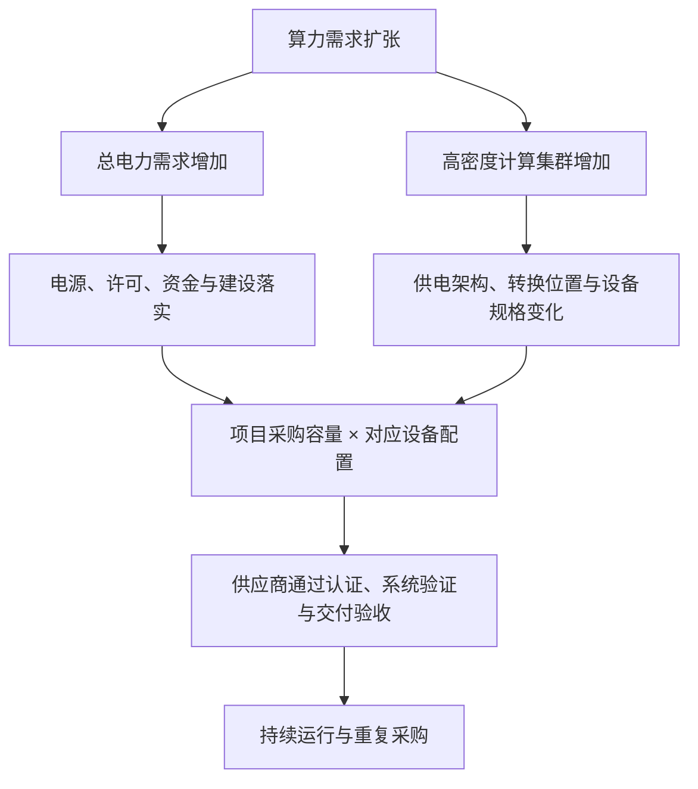

# 数据中心供配电：行业逻辑

**总量看可交付MW，结构看供电架构，竞争看系统验证与重复交付。**

行业处于“成熟电气产品承接建设扩张、800VDC进入早期产业化”的叠加阶段。电力总量决定设备需求基础，机柜密度决定规格与转换位置；两者最终在具体项目的设备清单中汇合。

整理：2026-09-28｜基于既有笔记、讨论与行业报告｜范围：供配电、储能及现场发电接口；不含估值和盈利分析。

## 1. 两条驱动线：总量扩张与密度提升

IEA预计全球数据中心用电量由2025年的485 TWh增至2030年的约950 TWh，支持需求扩张判断；但用电量增长还可能来自存量提负荷，不能直接当作新增设备市场增速。[来源：IEA][iea]

密度提升是另一条线：更多计算集中到单柜，电流、导体体积、连接和散热约束加重。同一600 kW直流负荷，在54 V下约需11.1 kA，在800 V下约需750 A。升压缓解输电约束，但整站节能仍取决于转换链路与实际配置。

## 2. 需求兑现：从项目公告走到设备采购

**规划容量 → 电源及其他条件落实 → 采购建设 → 通电验收 → 上架运行。** 各环节可以交叉推进，统计必须分开：项目延期可能影响新下单，也可能只延后已订设备的安装；延期、取消和缩减规模分别记录。

按项目和架构估算：

> **新建及改造设备机会 ≈ Σ（进入采购的有效IT MW × 对应配置的每MW设备金额）**

配置已含冗余时不再乘备用系数；改造按实际改动范围计价。母线、连接器还需按长度、支路和电流拆分，储能同时看MW与MWh，存量替换另算。集中化可能减少重复设备，因此MW增长与设备金额增长不一定同步。

项目数据库保留原始容量及定义，再增加统一IT口径；中国的机架数、设施MW与北美园区规划MW不能直接相加。PUE和利用率转换必须有依据。

## 3. 架构迁移：功能保留，位置与形态变化

800V输入、机柜内部原生800V、大厅800V配电是三个层次。NVIDIA第二版仍保留54V机柜路线，并把以下方案定义为可并存的部署选项。[来源：NVIDIA第二版，第6—23页][nvidia]

| 路径 | 适用条件与变化 | 设备研究重点 |
| --- | --- | --- |
| 传统AC | 既有设施及兼容负荷 | 中低压配电、UPS、机柜电源继续承接需求 |
| A：机柜侧Power Rack | 保留上游AC，靠近机柜整流 | 旁置电源、可选BBU、机柜DC/DC；兼顾兼容性与空间 |
| B：集群级Power Center | 在行末或集群集中整流 | 整流模块、DC母线、分接与保护；验证集群兼容性 |
| C：大厅级DC Power Block | 更大范围集中转换与DC配电 | TRU或SST、DC开关板、备用与切换；系统验证范围扩大 |

由此产生三项产业含义：

- **替代发生在具体区段。** 集中低压AC UPS、部分AC配电与机柜AC电源在某些方案中减少；整流、DC/DC、DC配电、保护及控制的重要性上升。中压接入和辅助AC负荷仍然存在。
- **800V不以SST为前提。** 工频变压器加整流器的TRU也能实现800V；SST份额取决于目标电压下的可靠性、认证、交付与系统成本，不能用全部800V容量当作SST市场。
- **储能与发电按任务组合。** 电容、BBU和BESS服务于负载平滑、故障桥接和短时备电；持续能源缺口仍需电网或现场发电。电池容量不能替代燃料与补能条件。

## 4. 竞争逻辑：从产品参数走向可复制系统

客户购买的是按期交付、能够稳定运行的容量。传统电气厂商擅长中压、保护与服务；电源厂商擅长高密度转换与模块制造。新架构要求双方补齐系统能力，历史地位不会自动变成新平台份额。

研究供应商时，沿同一条证据链推进：

**产品发布 → 型号认证 → 系统兼容测试 → 明确订单 → 现场验收 → 稳定运行 → 重复采购。**

直流故障处理需要限流、接地、保护与切换协同；单个器件获证不等于完整系统通过验证。联合设计经验、批量质量、交期及现场服务构成壁垒。标准化有助于扩大市场，也可能降低切换成本、推动多供应商采购。[工程依据：Schneider WP213][schneider]

中国厂商的既有直流经验和制造能力是基础，海外机会仍需逐项核对电压等级、平台准入、当地认证和服务覆盖。

## 5. 主要矛盾与验证指标

两项主要矛盾：**容量需求与可交付电力之间的距离；800V技术方向与系统成熟度之间的距离。**

| 要验证什么 | 优先跟踪的证据 | 需要调整判断的信号 |
| --- | --- | --- |
| 总量能否兑现 | 已锁定电源的分期IT MW、设备采购、通电验收 | 接入持续延后、规模缩减、订单取消 |
| 800V能否扩散 | 兼容平台到位、实际验收MW、跨项目复制 | 仅有新品展示，认证或现场部署停滞 |
| 设备需求如何迁移 | 同边界设备清单、整流位置、每MW配置 | 集中化减少的设备超过新增内容 |
| 谁能取得持续订单 | 明确客户、准时交付、故障恢复与复购 | 反复降额、兼容问题、客户转向替代方案 |

**基准判断：** AC与多种DC方案并存，机柜侧及集群级部署先推进，大厅级方案按项目验证。若原生800V平台、保护体系和系统认证加快成熟，集中转换可能提前扩散；短期电源或平台延误，主要影响采购节奏。需求减弱、资金无法落实或供电约束长期无法解除，则可能压低可兑现总量。

研究最终落在两张表：**项目分期与交付状态表**回答需求何时兑现；**架构设备清单与供应商验证表**回答采购什么、由谁交付。以上阶段与情景为研究判断，产品路线图不等于已完成部署。

---

延伸阅读：[既有研究笔记][notes]。主要一手资料：[IEA需求展望][iea]、[NVIDIA第二版白皮书][nvidia]、[Schneider 800V部署原则][schneider]。涉及预测和架构的判断按各来源版本理解。

[iea]: https://www.iea.org/reports/key-questions-on-energy-and-ai/executive-summary
[nvidia]: https://dam-cdn.nvd.orangelogic.com/AssetLink/7rj0u54stc41tk6s57dbs2p0qdte5874.pdf
[schneider]: https://www.se.com/us/en/download/document/SPD_WP213_EN/
[notes]: https://github.com/MikeYangJY/Data_Center
